# BUITEMS Lost & Found (Flutter + Firebase)

A mobile app for BUITEMS students to report and find lost items.

## Features
- Email/password, Google, and Phone (OTP) sign-in
- Restricted to `@buitems.edu.pk` accounts for email signup
- Post lost/found items with photo (Firebase Storage)
- Browse with search + category + type filters
- Item details with Call / WhatsApp / Email contact actions
- My Posts: edit, delete, change status (active / returned / closed)
- Profile screen

## 📱 Screen Preview

|                                                    |                                                    |                                                    |
| -------------------------------------------------- | -------------------------------------------------- | -------------------------------------------------- |
| 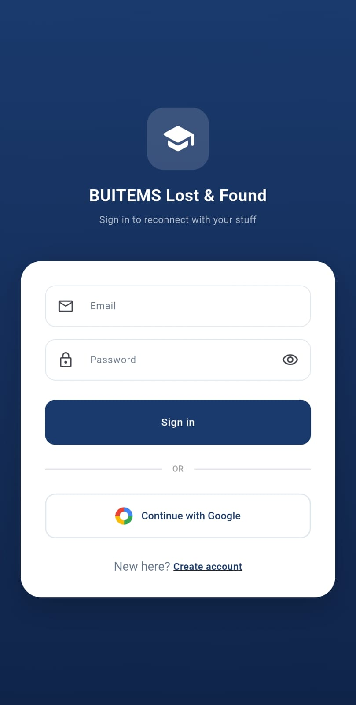   | 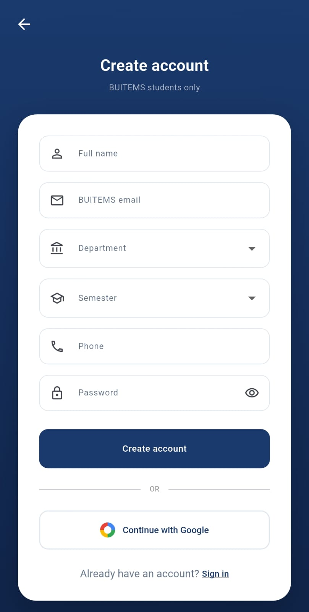   | 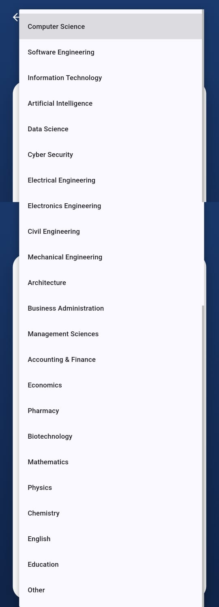   |
| 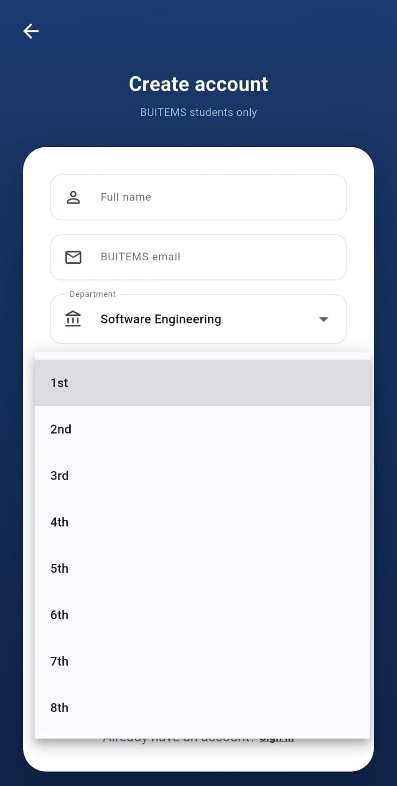   | 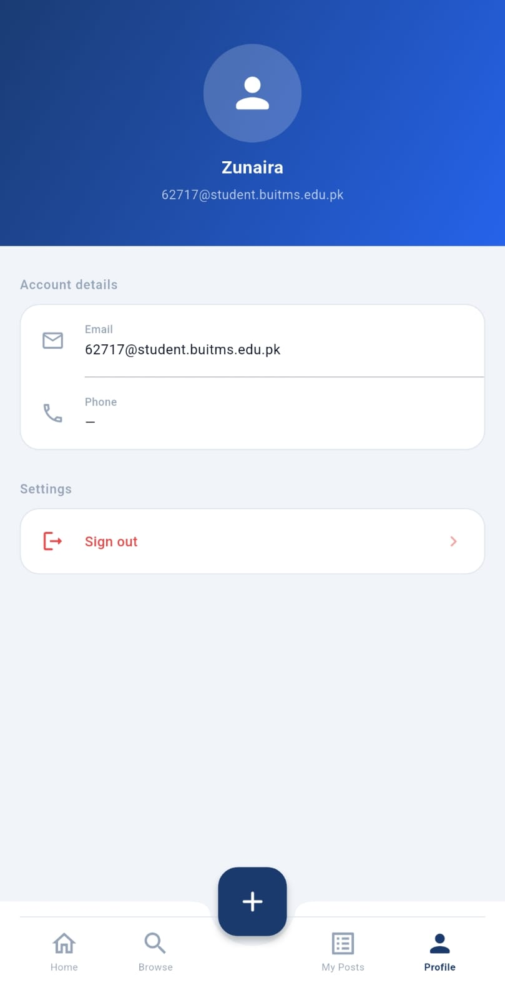   | 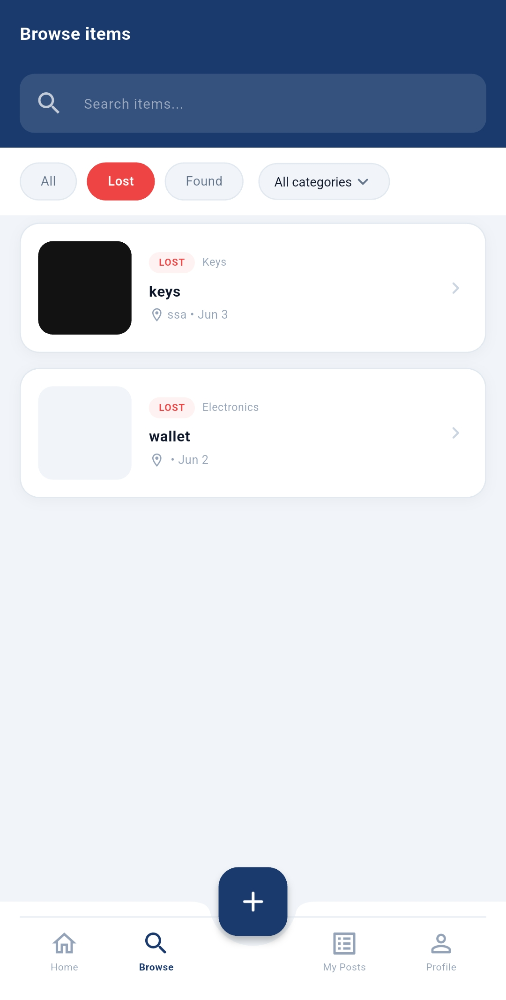   |
| 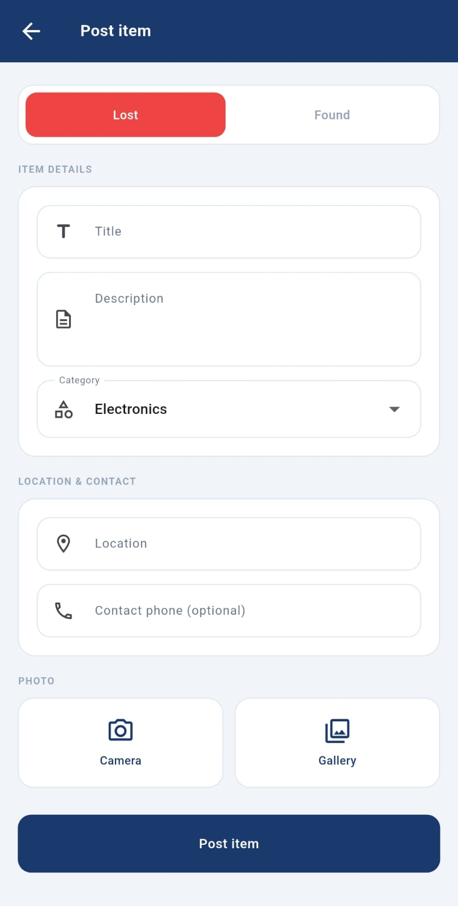   | 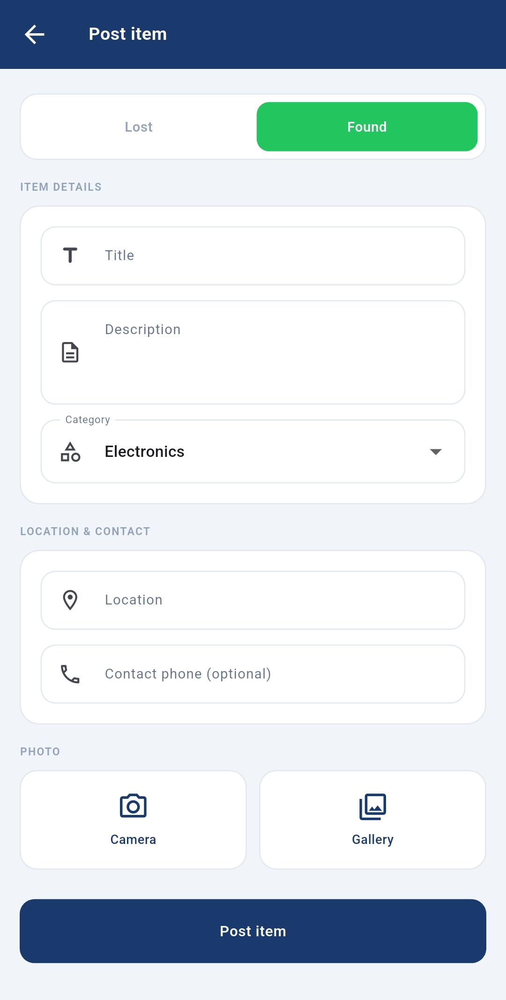   | 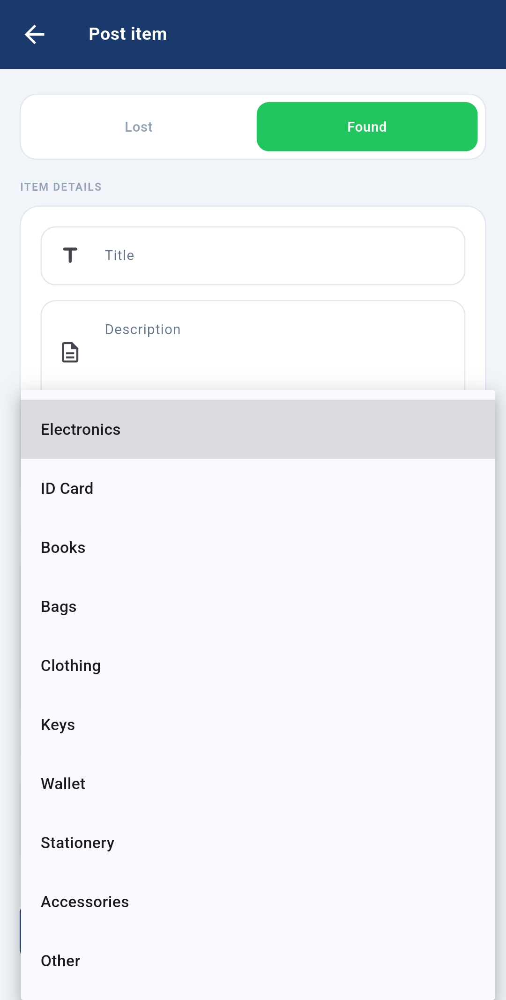   |
| 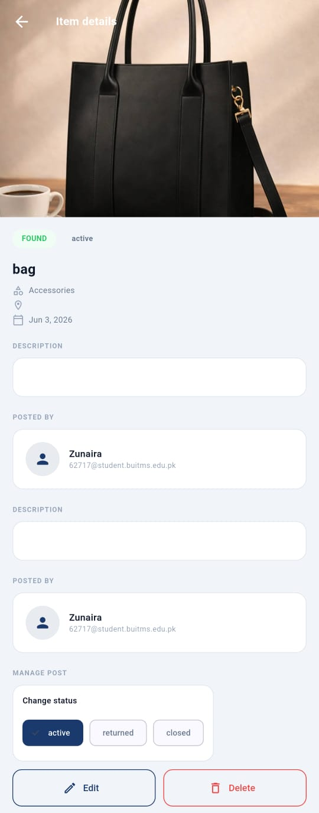 | 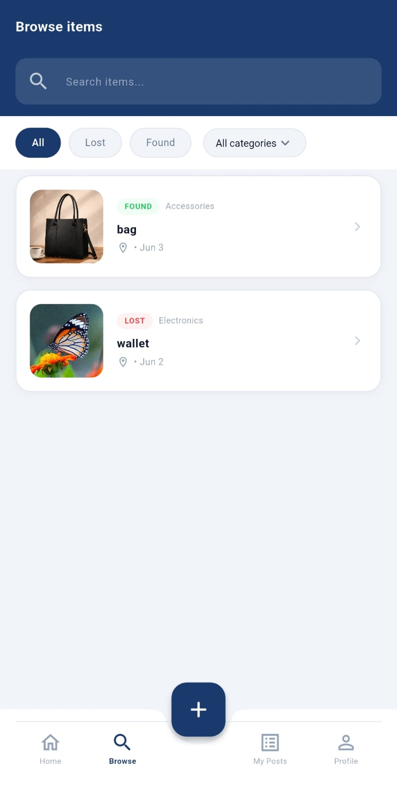 | 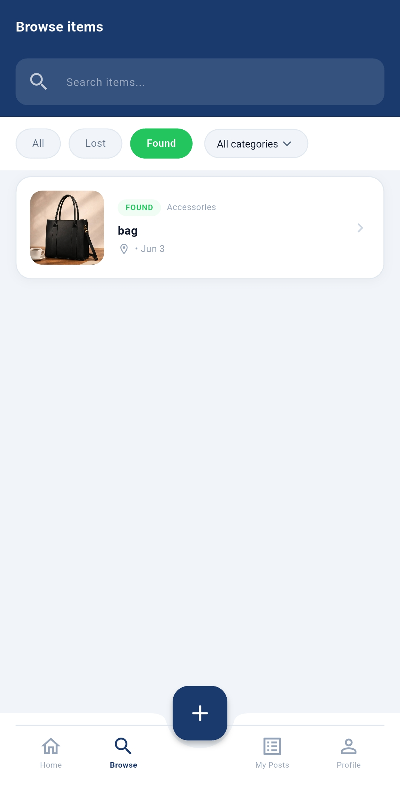 |
| 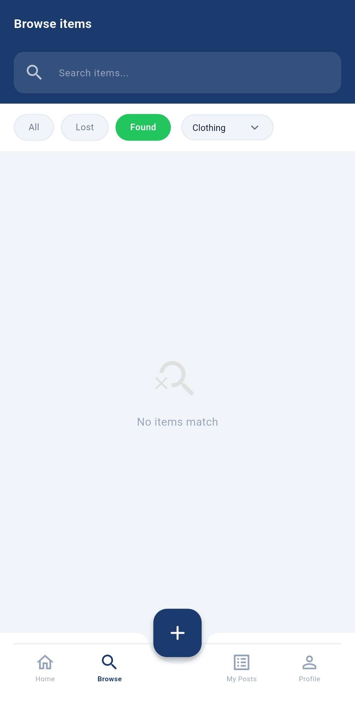 |  | 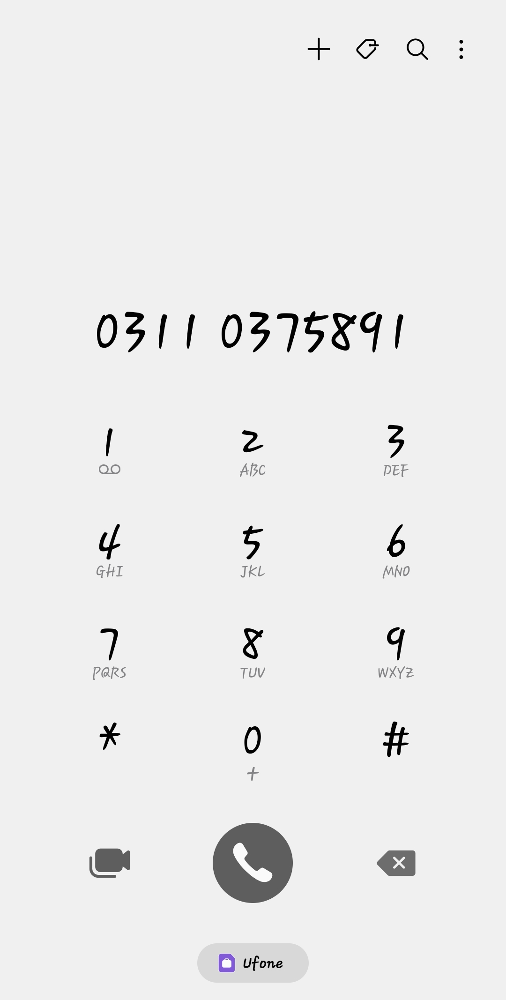 |
| 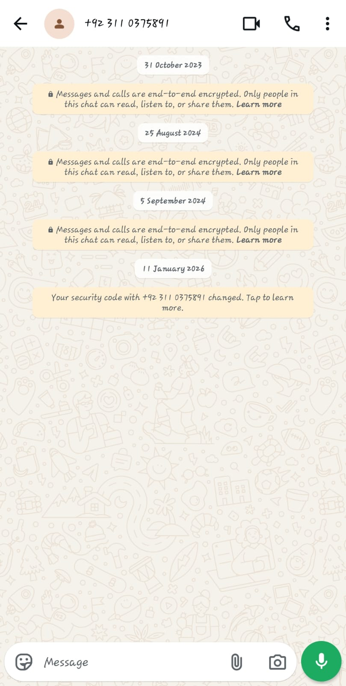 | 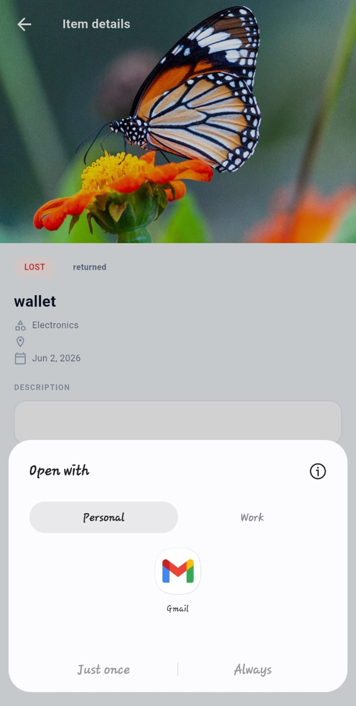 | 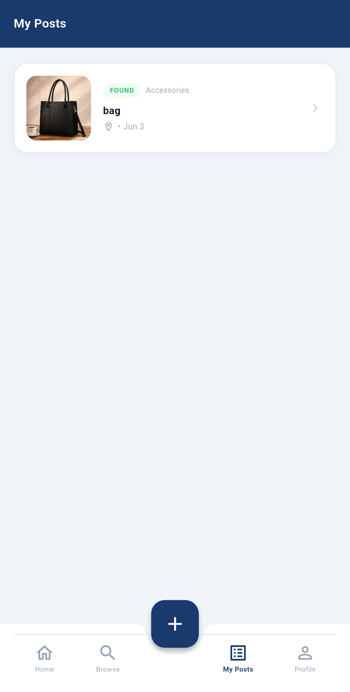 |


## Project Structure
```
buitems_lost_found/
├── pubspec.yaml
├── README.md
├── firebase.json                  # generated by `flutterfire configure`
├── lib/
│   ├── main.dart
│   ├── firebase_options.dart      # generated by `flutterfire configure`
│   ├── app_theme.dart
│   ├── models/
│   │   ├── item.dart
│   │   └── app_user.dart
│   ├── services/
│   │   ├── auth_service.dart
│   │   ├── item_service.dart
│   │   └── storage_service.dart
│   ├── widgets/
│   │   ├── item_card.dart
│   │   └── mobile_shell.dart
│   └── screens/
│       ├── splash_screen.dart
│       ├── login_screen.dart
│       ├── signup_screen.dart
│       ├── phone_login_screen.dart
│       ├── dashboard_screen.dart
│       ├── browse_screen.dart
│       ├── post_item_screen.dart
│       ├── item_detail_screen.dart
│       ├── my_posts_screen.dart
│       └── profile_screen.dart
└── android/app/google-services.json   # download from Firebase console
```

## Setup

### 1. Install Flutter
https://docs.flutter.dev/get-started/install (Flutter 3.19+, Dart 3.3+)

### 2. Create a Firebase project
1. Go to https://console.firebase.google.com → Add project
2. Enable **Authentication** → Sign-in methods: Email/Password, Google, Phone
3. Enable **Cloud Firestore** (start in production mode, paste rules below)
4. Enable **Storage** (paste rules below)

### 3. Wire Firebase to the Flutter app
```bash
dart pub global activate flutterfire_cli
cd buitems_lost_found
flutter pub get
flutterfire configure
```
This generates `lib/firebase_options.dart` and `firebase.json`, and adds platform files
(`android/app/google-services.json`, iOS GoogleService-Info.plist).

### 4. Android extras
- In `android/app/build.gradle` set `minSdkVersion 23`.
- For Google Sign-In: add your debug SHA-1 to Firebase project settings.
  ```bash
  cd android && ./gradlew signingReport
  ```
- For Phone OTP: enable the Android Device Verification API in Google Cloud console
  and add SHA-1 + SHA-256.

### 5. Firestore rules
```
rules_version = '2';
service cloud.firestore {
  match /databases/{db}/documents {
    match /users/{uid} {
      allow read: if request.auth != null;
      allow write: if request.auth != null && request.auth.uid == uid;
    }
    match /items/{itemId} {
      allow read: if request.auth != null;
      allow create: if request.auth != null
        && request.resource.data.posterId == request.auth.uid;
      allow update, delete: if request.auth != null
        && resource.data.posterId == request.auth.uid;
    }
  }
}
```

### 6. Storage rules
```
rules_version = '2';
service firebase.storage {
  match /b/{bucket}/o {
    match /items/{userId}/{file=**} {
      allow read: if request.auth != null;
      allow write: if request.auth != null && request.auth.uid == userId;
    }
  }
}
```

### 7. Run
```bash
flutter pub get
flutter run
```
